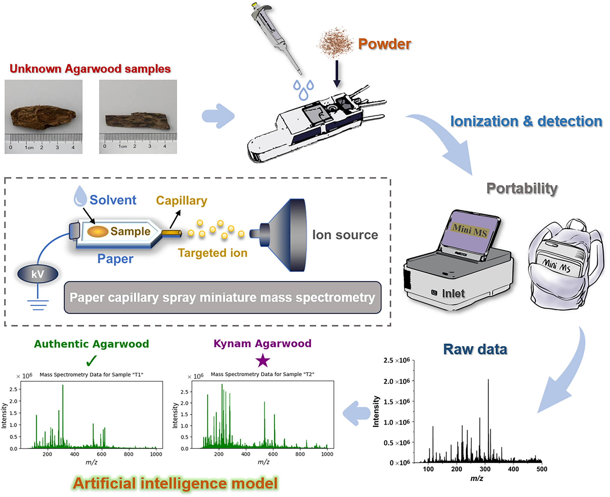
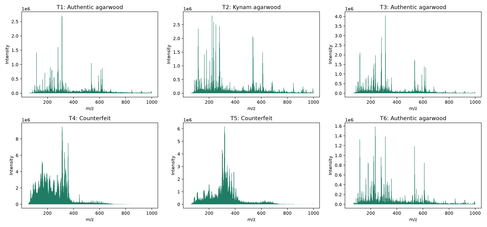

# AgarwoodMiniMS

A desktop application for mass-spectrum classification in rapid, on-site agarwood authentication workflows.

[中文说明](README.zh-CN.md)

## Background

The associated study combines paper capillary spray with miniature mass spectrometry for rapid, on-site authentication of agarwood. Powdered samples are placed on chromatography paper, extracted with solvent, and analyzed using a portable mass spectrometer. The study reports an analysis workflow of approximately one minute and uses spectral fingerprints with a random forest model to distinguish authentic agarwood, Kynam, and counterfeits.

AgarwoodMiniMS provides the software component of this workflow: training classification models and predicting sample classes from prepared spectral CSV tables. It includes the study's DEMO data and supports random forest, SVM, KNN, Gaussian naive Bayes, and gradient boosting.



Figure 1 from [Xie et al., Journal of Analysis and Testing (2025)](https://doi.org/10.1007/s41664-024-00331-0): the sampling, portable mass-spectrometry, and classification workflow.

## DEMO results



Actual output from AgarwoodMiniMS using random forest (`rf`) with the default `legacy` split. The model was trained on `demo_train.csv` and applied to `demo_predict.csv`. The panel titles show the predicted classes. DEMO spectra are from the [associated study](#citation).

## Installation

**Windows:** Extract the complete portable ZIP and open `AgarwoodMiniMS.exe`. Keep the `_internal` folder beside it.

**Source:** Use Python 3.11 or later. From the project directory:

```sh
python -m venv .venv
# Windows: .venv\Scripts\activate
# macOS/Linux: source .venv/bin/activate
python -m pip install .
agarwood-minims gui
```

## Try the DEMO

1. Keep `rf` and `legacy`, click **Train and evaluate**, select `demo/demo_train.csv`, and choose a results folder.
2. Click **Predict and save spectra**, select your newly generated `model.joblib`, confirm its trusted origin, and select `demo/demo_predict.csv`.
3. Choose a new output filename. The application saves predictions and a spectrum plot.

The DEMO includes 42 labeled training-table samples and six prediction samples from the paper's prepared spectral data.

## Use your own data

Follow the DEMO CSV layout: unique `Sample` identifiers, numeric m/z feature columns, and a `Label` column for training. Train a new model with your own labeled table, then predict your own samples using the same feature set. Select another algorithm and retrain to compare models.

## Citation

If you use this software or the DEMO data in your research, please cite:

Xie, Y., Huang, S., Zhang, Q., et al. On-Site Analysis and Rapid Authentication of Valuable Agarwood Samples by Paper Capillary Spray Miniature Mass Spectrometry. *Journal of Analysis and Testing* **9**, 61–70 (2025). [https://doi.org/10.1007/s41664-024-00331-0](https://doi.org/10.1007/s41664-024-00331-0)
